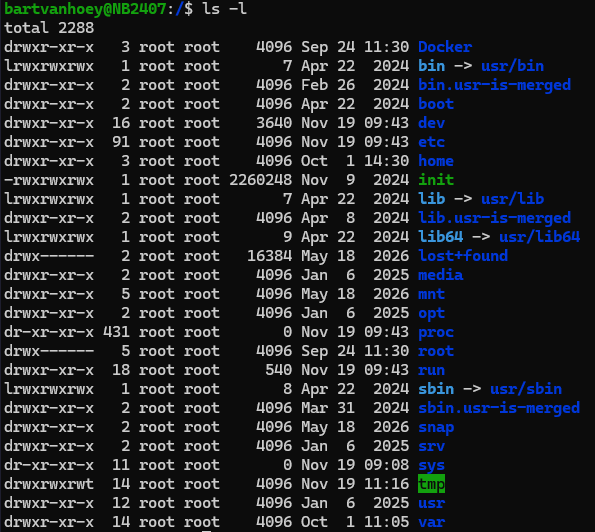

[← Week 1 - WSL2 as your daily driver](../weeks/week-01-wsl2-as-your-daily-driver.md)

# Week 1 - WSL2 as your daily driver: notes

**Status:** Not started

## Exercise 1

> Install WSL2 with Ubuntu LTS and Windows Terminal; install git and the .NET SDK inside WSL.

_Commands, results, what surprised me._

## Exercise 2

> Keep repos in the Linux filesystem (~/src), not under /mnt/c. Notice the speed difference.

_Commands, results, what surprised me._

## Exercise 3

> Do one full working day of git, dotnet build and dotnet test only from the WSL shell.

_Commands, results, what surprised me._

## Exercise 4

> Read The Linux Command Line (Shotts) part 1; start OverTheWire Bandit, levels 0-5.

```bash
# 2 - NAVIGATION
pwd # print working directory
ls # list all files in the current directory
cd ~/src # change directory to ~/src
cd /usr/bin # change directory to /usr/bin
cd .. # go up one directory level
cd / # change directory to the root directory
cd - # go back to the previous directory
cd -user_name # change directory to the home directory of user_name
cd ~ # change directory to the home directory of the current user
clear # clear the terminal screen

# 3 - EXPLORING THE SYSTEM

ls /etc # list all files in the /etc directory
ls ~ /usr # list all files in the /usr directory
ls -l # list all files with detailed information
ls -a # list all files, including hidden files
ls -lh # list all files with detailed information in human-readable format
ls -lt # list all files with detailed information sorted by modification time
ls -A # list all files, including hidden files, but excluding . and ..
ls -d */ # list only directories in the current directory
ls -R # list all files and directories recursively
ls -S # list all files with detailed information sorted by file size
ls -F # list all files with a trailing / for directories and * for executables

```



_Commands, results, what surprised me._

## Deliverable

> A working WSL dev setup and a short note of what felt different from Windows.

_Write-up._
