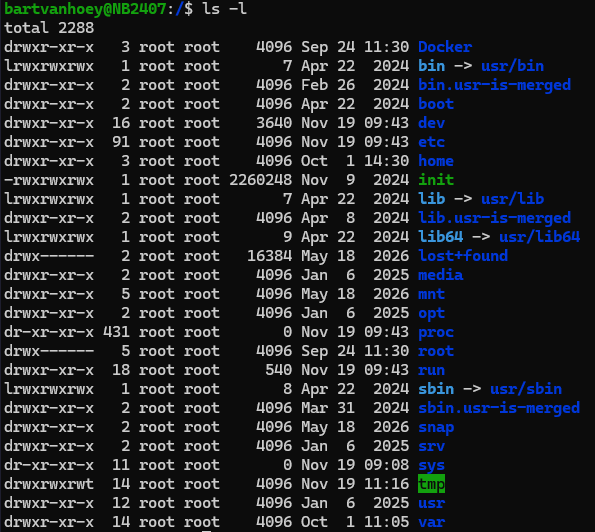

[← Week 1 - WSL2 as your daily driver](week-01-wsl2-as-your-daily-driver.md)

# Week 1 - WSL2 as your daily driver: notes

**Status:** Not started

## Exercise 1

> Install WSL2 with Ubuntu LTS and Windows Terminal; install git and the .NET SDK inside WSL.

**Status:** Done

### Quick setup (recommended)

1. Open PowerShell as Administrator.
2. Run `wsl --install`
   This enables the required Windows features, installs the WSL2 kernel, and installs Ubuntu by default.
3. Reboot when prompted.
4. After the reboot, Ubuntu launches and asks you to create a Linux username and password.

After the installation, you can check the WSL version with:

```bash
wsl --list --verbose
```

Update Linux after with:

```bash
sudo apt update && sudo apt upgrade -y
```

### Install the .NET 10 SDK

Ubuntu provides the .NET SDK in its own package feed, so no Microsoft package repository is needed:

```bash
sudo apt update
sudo apt install -y dotnet-sdk-10.0
dotnet --version # verify the installation, prints 10.0.x
```

### systemd in WSL

systemd is the init system and service manager on most modern Linux distros. It is the first process that starts at boot (PID 1) and it starts and manages background services such as SSH, databases, web servers and Docker. You talk to it with `systemctl`:

```bash
sudo systemctl start postgresql # start a service now
sudo systemctl enable nginx # start a service automatically at boot
systemctl status ssh # show the state of a service
```

WSL did not originally boot like a normal Linux machine, so `systemctl` failed with _System has not been booted with systemd as init system_. Recent WSL versions support systemd, but it may need to be switched on.

First check whether it is already running (newer Ubuntu installs often have it enabled):

```bash
systemctl is-system-running # prints running (or degraded, which is usually fine)
```

If not, enable it:

1. Edit `/etc/wsl.conf` inside the distro (create the file if it does not exist):

   ```bash
   sudo nano /etc/wsl.conf
   ```

   ```ini
   [boot]
   systemd=true
   ```

2. From PowerShell (not inside WSL), shut WSL down so the setting takes effect, then open the distro again:

   ```powershell
   wsl --shutdown
   ```

3. Verify with `systemctl is-system-running`.

You only need systemd if you want to run services the normal Linux way. It becomes important from [Week 7](../week-07/week-07-notes.md) onwards.

## Exercise 2

Files: Windows drives are mounted at /mnt/c/. For better performance, keep projects in the Linux filesystem (~/src) rather than /mnt/c/.

> Keep repos in the Linux filesystem (~/src), not under /mnt/c. Notice the speed difference.

```bash
# Linux filesystem
username@NB2407:~$ time git -C ~/src/MyGitHubRepos/LinuxInSixMonths status

# On branch main
# Your branch is up to date with 'origin/main'.

# nothing to commit, working tree clean

# real    0m0.002s
# user    0m0.002s
# sys     0m0.000s

# Same repo cloned on the Windows side
username@hostname:~$ time git -C /mnt/c/Personal/MyGitHubRepos/LinuxInSixMonths status
# On branch main
# Your branch is up to date with 'origin/main'.

# nothing to commit, working tree clean

# real    0m0.996s
# user    0m0.016s
# sys     0m0.000s
```

## Exercise 3

> Do one full working day of git, dotnet build and dotnet test only from the WSL shell.

### Problem: Could not read from remote repository

```bash
usernameB@hostname MINGW64 /c/Personal/MyGitHubRepos/LinuxInSixMonths (main)
$ git pull
git@github.com: Permission denied (publickey).
fatal: Could not read from remote repository.
Please make sure you have the correct access rights and the repository exists.

# Cause
# the remote uses SSH (git@github.com:bartvanhoey/LinuxInSixMonths.git), but ~/.ssh has  no GitHub key. There is no default id_ed25519 or id_rsa, no github.com entry in ~/.ssh/config, and no ssh-agent running.

# fix
# Switch to HTTPS instead of SSH for the remote, and use gh auth setup-git to use the GitHub token for authentication.
git remote set-url origin https://github.com/bartvanhoey/LinuxInSixMonths.git
gh auth setup-git
git pull

# gh auth setup-git makes git use the gh token for HTTPS, so there is no password prompt.

# To keep SSH instead of HTTPS , you would need to generate a key with ssh-keygen -t ed25519 and add the public key at github.com/settings/keys.
```

### Problem: `dotnet restore` fails with 401 on a private NuGet feed

A project that restores fine on Windows fails in WSL with `error NU1301 ... 401 (Unauthorized)` on a private Azure DevOps Server feed, even though the personal access token (PAT) is valid. The server offers `Negotiate` and `NTLM` next to `Basic`. On Linux, NuGet tries those with the PAT and does not fall back to Basic, while curl sends Basic right away. The fix is the Azure Artifacts Credential Provider with the PAT in `VSS_NUGET_EXTERNAL_FEED_ENDPOINTS`.

Step by step: [Restore from a private on-prem NuGet feed in WSL (401 Unauthorized)](nuget-private-feed-401-in-wsl.md).

_Commands, results, what surprised me._

## Exercise 4

> Read The Linux Command Line (Shotts) part 1; start OverTheWire Bandit, levels 0-5.

### 2 - NAVIGATION

```bash
# Navigate the filesystem
pwd # print working directory
ls # list all files in the current directory
cd ~/src # change directory to ~/src
cd /usr/bin # change directory to /usr/bin
cd .. # go up one directory level
cd / # change directory to the root directory
cd - # go back to the previous directory
cd -user_name # change directory to the home directory of user_name
cd ~ # change directory to the home directory of the current user
clear # clear the terminal screen
```

### 3 - EXPLORING THE SYSTEM

```bash
# List files and directories
ls /etc # list all files in the /etc directory
ls ~ /usr # list all files in the /usr directory
ls -l # list all files with detailed information
ls -a # list all files, including hidden files
ls -lh # list all files with detailed information in human-readable format
ls -lt # list all files with detailed information sorted by modification time
ls -A # list all files, including hidden files, but excluding . and ..
ls -d */ # list only directories in the current directory
ls -R # list all files and directories recursively
ls -S # list all files with detailed information sorted by file size
ls -F # list all files with a trailing / for directories and * for executables
file filename # display the description of the file type for filename
less filename # view the contents of filename one page at a time

```

#### Explanation of ls -l output



```bash
-rwxrwxrwx   1 root root 2260248 Nov  9  2024 init
```

The line above can be broken down as follows:

| Field          | Meaning                                                       |
| -------------- | ------------------------------------------------------------- |
| `-`            | File type: `-` regular file, `d` directory, `l` symbolic link |
| `rwx`          | Owner permissions: read, write, execute                       |
| `rwx`          | Group permissions: read, write, execute                       |
| `rwx`          | Permissions for everyone else: read, write, execute           |
| `1`            | Number of hard links                                          |
| `root`         | Owner of the file                                             |
| `root`         | Group of the file                                             |
| `2260248`      | Size in bytes (about 2.2 MB)                                  |
| `Nov  9  2024` | Last modification date                                        |
| `init`         | File name                                                     |

`rwxrwxrwx` is mode `777`: anyone can read, write and execute the file.

### Explanation of ls -li output

A hard link is an extra name for the same data. A file consists of a name and a data part. The system stores the data in a chain of disk blocks, described by an inode, and the name points to that inode. Every hard link to a file therefore points to the same inode, and so to the same contents.

Use the `-i` option of `ls` to show the inode number in front of each entry:

```bash
username@hostname:~/playground$ ls -li
total 16
45378 drwxr-xr-x 2 bartvanhoey bartvanhoey 4096 Nov 19 19:28 dir1
45386 drwxr-xr-x 2 bartvanhoey bartvanhoey 4096 Nov 19 19:28 dir2
45342 -rw-r--r-- 4 bartvanhoey bartvanhoey 1482 Nov 19 18:07 fun
45342 -rw-r--r-- 4 bartvanhoey bartvanhoey 1482 Nov 19 18:07 fun-hard
 2963 lrwxrwxrwx 1 bartvanhoey bartvanhoey    3 Nov 19 19:28 fun-sym -> fun
```

_Moved to [Week 2, Exercise 1](../week-02/week-02-notes.md#exercise-1): Directories of Linux Systems._

_Moved to [Week 2, Exercise 2](../week-02/week-02-notes.md#exercise-2): Example of a symbolic link._

### 4 Manipulating Files and Directories

```bash

mkdir # Create directories
cp # Copy files and directories
mv # Move or rename files and directories
rm # Remove files and directories
ln # Create hard and symbolic links
mv # Move or rename files and directories

cp -u *.html destination # Copy all .html files to destination if they are newer than the existing ones

```

#### Wildcards

The shell expands wildcards (globs) into matching file names before the command runs.

| Wildcard      | Matches                                                                                  |
| ------------- | ---------------------------------------------------------------------------------------- |
| `*`           | Any characters, including none: `*.html`, `report*`                                      |
| `?`           | Exactly one character: `file?.txt` matches `file1.txt`, not `file10.txt`                 |
| `[abc]`       | Any one character from the set: `file[123].txt`                                          |
| `[!abc]`      | Any one character not in the set: `file[!0-9].txt`                                       |
| `[a-z]`       | Any one character in the range: `[A-Z]*` matches names starting with an uppercase letter |
| `[[:alpha:]]` | Any alphabetic character (POSIX class)                                                   |
| `[[:digit:]]` | Any digit                                                                                |
| `[[:upper:]]` | Any uppercase letter                                                                     |
| `[[:lower:]]` | Any lowercase letter                                                                     |
| `[[:alnum:]]` | Any letter or digit                                                                      |

```bash
ls *.txt # all files ending in .txt
ls ???  # all files with exactly three characters
ls [[:upper:]]* # all files starting with an uppercase letter
ls *[![:digit:]] # all files not ending with a digit
```

#### mkdir - Create directories

```bash
    mkdir dir1
    mkdir dir1 dir2 dir3 # Create multiple directories at once
    mkdir dir1/dir2/dir3 # Create nested directories
```

#### cp - Copy files and directories

```bash
    cp input.txt output.txt # Copy input.txt to output.txt
    cp item... directory # Copy multiple items to a directory
```

Common `cp` options:

| Option | Long option     | Meaning                                                                                                                                                      |
| ------ | --------------- | ------------------------------------------------------------------------------------------------------------------------------------------------------------ |
| `-a`   | `--archive`     | Copy files and directories with all attributes, including ownership and permissions. Normally copies take the default attributes of the user doing the copy. |
| `-i`   | `--interactive` | Prompt before overwriting an existing file. Without it, `cp` overwrites silently.                                                                            |
| `-r`   | `--recursive`   | Copy directories and their contents. Required for directories (or use `-a`).                                                                                 |
| `-u`   | `--update`      | Copy only files that do not exist in the destination or are newer than the existing ones. Skips files that need no copy.                                     |
| `-v`   | `--verbose`     | Show informative messages while copying.                                                                                                                     |

Common `cp` applications:

| Command               | Result                                                                                                                         |
| --------------------- | ------------------------------------------------------------------------------------------------------------------------------ |
| `cp file1 file2`      | Copy `file1` to `file2`. If `file2` exists, it is overwritten; otherwise it is created.                                        |
| `cp -i file1 file2`   | Same, but prompt before overwriting `file2`.                                                                                   |
| `cp file1 file2 dir1` | Copy `file1` and `file2` into `dir1`. `dir1` must already exist.                                                               |
| `cp dir1/* dir2`      | Copy all files in `dir1` into `dir2` (wildcard). `dir2` must already exist.                                                    |
| `cp -r dir1 dir2`     | If `dir2` does not exist, create it with the contents of `dir1`. If `dir2` exists, copy `dir1` (and its contents) into `dir2`. |

#### mv - Move or rename files and directories

```bash
    mv input.txt output.txt # Move input.txt to output.txt
    mv item... directory # Move multiple items to a directory
```

Common `mv` options (same meaning as for `cp`):

| Option | Long option     | Meaning                                                                                   |
| ------ | --------------- | ----------------------------------------------------------------------------------------- |
| `-i`   | `--interactive` | Prompt before overwriting an existing file. Without it, `mv` overwrites silently.         |
| `-u`   | `--update`      | Move only files that do not exist in the destination or are newer than the existing ones. |
| `-v`   | `--verbose`     | Show informative messages while moving.                                                   |

Common `mv` applications:

| Command               | Result                                                                                                           |
| --------------------- | ---------------------------------------------------------------------------------------------------------------- |
| `mv file1 file2`      | Move (rename) `file1` to `file2`. If `file2` exists, it is replaced. Either way, `file1` no longer exists.       |
| `mv -i file1 file2`   | Same, but prompt before replacing `file2`.                                                                       |
| `mv file1 file2 dir1` | Move `file1` and `file2` into `dir1`. `dir1` must already exist.                                                 |
| `mv dir1 dir2`        | If `dir2` does not exist, rename `dir1` to `dir2`. If `dir2` exists, move `dir1` (and its contents) into `dir2`. |

#### rm - Remove files and directories

```bash
    rm file1 file2 # Remove files
    rm -r dir1 # Remove a directory and its contents recursively
```

Common `rm` options:

| Option | Long option     | Meaning                                                                                                  |
| ------ | --------------- | -------------------------------------------------------------------------------------------------------- |
| `-i`   | `--interactive` | Prompt before deleting a file. Without it, `rm` deletes silently.                                        |
| `-r`   | `--recursive`   | Delete directories and everything inside them, including subdirectories. Required to delete a directory. |
| `-f`   | `--force`       | Ignore nonexistent files and never prompt. Overrides `--interactive`.                                    |
| `-v`   | `--verbose`     | Show informative messages while deleting.                                                                |

Common `rm` applications:

| Command            | Result                                                   |
| ------------------ | -------------------------------------------------------- |
| `rm file1`         | Delete `file1` silently.                                 |
| `rm -i file1`      | Same, but prompt for confirmation first.                 |
| `rm -r file1 dir1` | Delete `file1`, and delete `dir1` with all its contents. |

> **Warning:** Linux has no recycle bin. `rm` deletes permanently, and `rm -rf` does so without asking. Check the wildcard or path with `ls` first.

### Problem: `mkdir` fails with "Permission denied" in `/home/playground`

```bash

username@hostname:/home/playground$ mkdir dir1 dir2
mkdir: cannot create directory ‘dir1’: Permission denied
mkdir: cannot create directory ‘dir2’: Permission denied

# /home/playground is owned by root with mode 755, so I can't create anything in it.

# fix
# Take ownership of the directory with chown, then mkdir dir1 dir2 will work.
sudo chown -R $USER:$USER /home/playground
```

## Problems encountered

Problems with the tools around the exercises. Problems from an exercise are noted under that exercise.

### herdr comes back without my Claude Code session

After a Windows shutdown or `wsl --shutdown`, herdr restores the workspaces and tabs, but the `claude` tab is an empty shell. The WSL VM stopped, and every process stopped with it. herdr restores only the layout, not the running programs. The conversation is still saved in `~/.claude/projects/`. Run `claude --continue` (alias `clc`, see below) to reopen it, or `claude --resume` to pick an older one.

Details: [herdr "loses" Claude Code sessions in WSL](herdr-loses-claude-sessions-in-wsl.md).

### The markdownlint pre-push hook lints 0 files

`git push` showed `UNC paths are not supported` and `Linting: 0 files`, and the push went through while the GitHub check failed. Node.js was only installed on Windows, so `npx` was the Windows one (`/mnt/c/...`). It runs through `cmd.exe`, which can't use a WSL folder and falls back to `C:\Windows`, where no files match. The fix is `sudo apt install nodejs npm` in WSL, plus a hook that stops the push when `npx` is missing or is the Windows one.

Details: [The markdownlint pre-push hook lints 0 files in WSL](markdownlint-hook-lints-0-files-in-wsl.md).

## Tips

### Alias `clc` to resume Claude Code

An alias is a short name for a longer command. `clc` runs `claude --continue`, which reopens the most recent Claude Code conversation in the current folder.

1. Check that the name is not already a command:

   ```bash
   type clc    # "bash: type: clc: not found" means the name is free
   ```

   I first wanted `cc`, but that is the C compiler (`/usr/bin/cc`) and the alias would hide it.

2. Add the alias to `~/.bash_aliases`. The default Ubuntu `~/.bashrc` loads this file if it exists, so you don't have to edit `~/.bashrc` itself:

   ```bash
   echo "alias clc='claude --continue'" >> ~/.bash_aliases
   ```

3. Load it in the current shell (new terminals load it automatically):

   ```bash
   source ~/.bashrc
   ```

4. Check it:

   ```bash
   type clc    # clc is aliased to `claude --continue'
   alias       # list all aliases
   ```

To remove the alias in the current shell, run `unalias clc`. To remove it for good, delete the line from `~/.bash_aliases`.

### See uncommitted changes (the herdr spaces menu doesn't show them)

The `git_status` item in the herdr spaces menu shows how many commits the branch is ahead of or behind its remote, not how many files are changed. herdr has no item for uncommitted changes. Instead, a Claude Code status line script shows the branch and the number of changed, staged and new files under the Claude Code input box.

Details: [See git changes while working in Claude Code](claude-code-status-line-git-changes.md).

## Deliverable

> A working WSL dev setup and a short note of what felt different from Windows.

Tip: **Visual Studio Code** can be installed in Windows and used to edit files in WSL. In VS Code, open the extensions panel (Ctrl+Shift+X) and search for WSL (publisher Microsoft).

The first time when you run `code .`, VS Code installs a small "VS Code Server" inside your distro. After that, the window opens with a green WSL: Ubuntu label in the bottom-left corner. It will automatically detect the WSL environment and use the Linux toolchain for building and debugging. This allows you to have a seamless development experience while leveraging the power of Linux within Windows.
